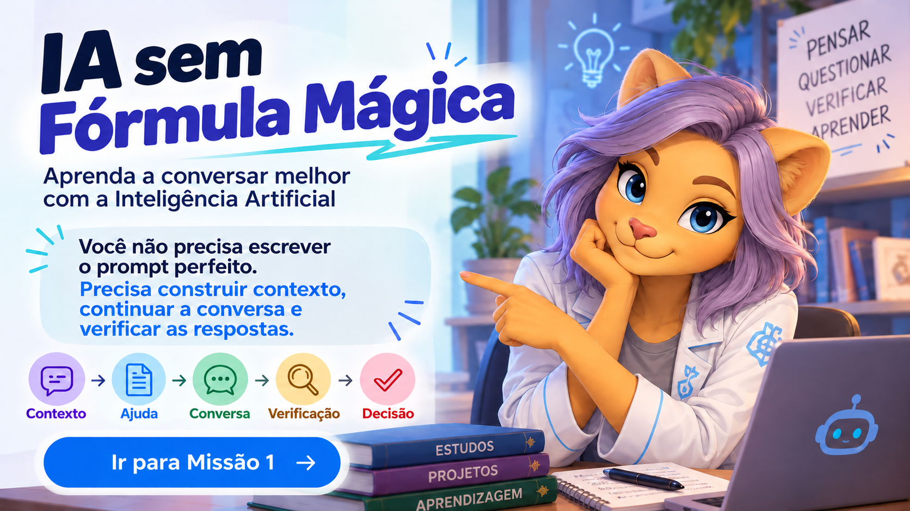

# Missão 0 — IA não é mágica

## Uma resposta pronta não é a mesma coisa que aprendizagem

Você faz uma pergunta.

A IA responde em poucos segundos.

O texto parece organizado.

Parece correto.

Parece convincente.

Mas isso significa que você aprendeu?

**Não necessariamente.**

A Inteligência Artificial pode ajudar muito, mas ela não entende automaticamente sua situação, pode interpretar errado o que você quis dizer e também pode apresentar respostas incompletas ou incorretas.

Por isso, o objetivo deste minicurso não é ensinar você a conseguir respostas mais rápidas.

O objetivo é aprender a **trabalhar melhor com a IA**.

---

## O caminho mais fácil nem sempre ajuda você a aprender

Imagine que o professor peça:

> Pesquise sobre banco de dados e explique a diferença entre chave primária e chave estrangeira.

Você abre uma ferramenta de IA e escreve:

> Faça meu trabalho sobre chave primária e chave estrangeira.

A IA produz um texto.

Você copia.

Entrega.

Atividade concluída?

Talvez.

Aprendizagem concluída?

Provavelmente ainda não.

Se alguém perguntar:

> Por que uma chave estrangeira é necessária?

Você consegue explicar sem consultar o texto?

Se não consegue, a IA ajudou a produzir a atividade, mas não necessariamente ajudou você a aprender.

---

## A IA pode fazer parte do aprendizado

Agora imagine outra situação.

Você escreve:

> Estou estudando banco de dados. Entendi que a chave primária identifica um registro, mas ainda não entendi bem para que serve a chave estrangeira. Explique usando um exemplo simples e depois faça uma pergunta para verificar se eu entendi.

A IA responde.

Você lê.

Ainda ficou com dúvida?

Continue:

> Não entendi a parte do relacionamento entre as tabelas. Pode explicar de outra forma?

Depois:

> Agora me dê um pequeno exemplo e não forneça a resposta completa.

Perceba a diferença.

No primeiro caso:

**Perguntar → Receber → Copiar**

No segundo:

**Perguntar → Entender → Questionar → Testar → Continuar**

A ferramenta pode ser a mesma.

O modo de usar mudou completamente.

---

## IA não é um oráculo

Uma resposta bem escrita pode estar errada.

A IA pode:

- interpretar sua pergunta de forma diferente do que você pretendia;
- inventar informações;
- confundir conceitos;
- utilizar informações desatualizadas;
- apresentar uma solução que não serve para sua atividade;
- responder com confiança mesmo quando está equivocada.

Isso significa que você não deve usar IA?

Não.

Significa que você precisa aprender a **verificar**.

---

## Nem sempre o problema está na resposta

Às vezes, a dificuldade começa antes.

Veja este pedido:

> explica isso pra mim

O que é “isso”?

Qual é a disciplina?

O que você já sabe?

Qual parte você não entendeu?

Que tipo de explicação ajudaria?

Se nem outra pessoa consegue entender claramente sua pergunta, a IA também terá dificuldade.

Por isso, uma das competências mais importantes ao trabalhar com IA é aprender a **explicar melhor o problema**.

---

## Você não precisa saber tudo antes de perguntar

Dar contexto não significa que você precisa dominar o assunto.

Você pode dizer:

> Não sei por onde começar.

Ou:

> Li a atividade, mas não entendi o que o professor está pedindo.

Ou ainda:

> Acho que entendi uma parte, mas não tenho certeza.

Isso já é contexto.

Reconhecer o que você não sabe também faz parte da aprendizagem.

---

## O prompt perfeito não existe

Na internet e nas redes sociais aparecem muitos conteúdos prometendo:

> “O prompt definitivo.”

> “Use estas palavras e obtenha respostas perfeitas.”

> “Este comando transforma qualquer IA em especialista.”

Algumas dessas técnicas podem ser úteis.

Mas nenhuma fórmula elimina a necessidade de:

- saber o que você quer;
- explicar sua situação;
- continuar a conversa;
- analisar a resposta;
- verificar informações;
- tomar decisões.

Um prompt enorme não garante uma boa resposta.

Uma conversa simples e bem construída pode ser muito mais útil.

---

## A competência continua sendo humana

Trabalhar bem com IA depende de competências que continuam sendo suas.

Você precisa aprender a:

**Contextualizar → Orientar → Questionar → Verificar → Decidir**

Ao longo das próximas missões, você vai praticar cada uma delas.

---

## Microdesafio

Observe os dois pedidos abaixo.

### Pedido A

> Faça um programa em C++ usando função.

### Pedido B

> Estou aprendendo funções em C++. Já sei declarar variáveis e usar `if`, mas ainda não entendi bem como passar valores para uma função. Não faça o exercício por mim. Explique com um exemplo pequeno e depois proponha um exercício simples para eu tentar sozinho.

Responda:

1. Qual dos dois pedidos fornece mais contexto?
2. Que informações do Pedido B ajudam a IA a responder melhor?
3. O Pedido B tenta substituir o trabalho do aluno ou apoiar a aprendizagem?
4. Como você melhoraria ainda mais esse pedido?

---

## Experimente

Escolha uma atividade que você esteja fazendo atualmente.

Antes de pedir uma resposta para a IA, tente explicar:

- o que você está estudando;
- o que precisa fazer;
- o que já sabe;
- onde está sua dificuldade;
- como gostaria de ser ajudado.

Depois, compare a resposta com aquela que receberia fazendo apenas uma pergunta genérica.

---

## Regra de ouro

> **A IA pode ajudar você a pensar, mas não substitui sua compreensão.**

E lembre-se:

> **Se você não entendeu a resposta, a conversa ainda não terminou.**

---

## Próxima missão

Na próxima etapa, vamos preparar melhor o ambiente de trabalho e entender por que organização, continuidade e histórico fazem diferença.

[Ir para a Missão 1 — Prepare a conversa](01-prepare-a-conversa.md)

[Voltar para o início](index.md)

