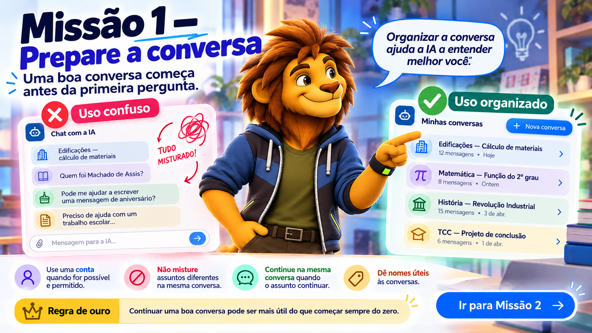

# Missão 1 — Prepare a conversa

## Uma boa conversa começa antes da primeira pergunta

Quando você usa uma ferramenta de Inteligência Artificial, pode simplesmente abrir a página, fazer uma pergunta e fechar.

Isso funciona para dúvidas rápidas.

Mas, quando você está estudando um conteúdo, desenvolvendo uma atividade ou trabalhando em um projeto por vários dias, é melhor organizar a conversa.

A IA responde com base no que está disponível naquele momento.

Quanto melhor organizado estiver o contexto, mais fácil será continuar o trabalho.

---

## Use uma conta quando for possível e permitido

Em muitas ferramentas de IA, utilizar uma conta permite manter:

- histórico das conversas;
- continuidade entre diferentes momentos de estudo;
- organização dos assuntos;
- acesso posterior ao que já foi discutido;
- materiais e informações relacionados ao mesmo trabalho.

Sem uma conta, a interação tende a ser mais temporária.

Você pergunta.

Recebe a resposta.

Fecha a página.

Depois precisa começar novamente.

Isso não significa que seja obrigatório utilizar uma conta.

Existem situações em que:

- a família pode não autorizar;
- a escola pode possuir regras específicas;
- o serviço pode estabelecer restrições de idade;
- pode haver questões de privacidade;
- o acesso pode não estar disponível.

Por isso, siga sempre as orientações da sua família, da escola e da própria ferramenta.

> **Quando for possível e permitido, manter suas conversas organizadas facilita a continuidade do aprendizado.**

---

## Não use uma única conversa para tudo

Imagine esta sequência:

> Como calcular a quantidade de material necessária para uma parede?

Depois:

> Quem foi Machado de Assis?

Depois:

> Faça uma mensagem de aniversário.

Depois:

> Voltando ao cálculo da parede, por que meu resultado ficou diferente?

Talvez a IA consiga acompanhar.

Mas você está misturando assuntos diferentes dentro do mesmo espaço.

Isso torna a conversa mais difícil de organizar e pode criar informações desnecessárias no contexto.

Uma ideia simples é:

**um assunto importante → uma conversa própria**

Por exemplo:

- Edificações — Cálculo de materiais;
- Matemática — Função do 2º grau;
- Literatura — Machado de Assis;
- TCC;
- Trabalho de História;
- Projeto interdisciplinar.

---

## Continue na mesma conversa quando o assunto continuar

O problema contrário também existe.

Algumas pessoas começam uma nova conversa para cada pergunta.

Exemplo:

### Conversa 1

> O que é fundação rasa?

### Conversa 2

> Qual a diferença entre sapata e radier?

### Conversa 3

> Como o tipo de solo influencia essa escolha?

Se tudo isso faz parte do mesmo estudo, continuar na mesma conversa pode ser mais útil.

A IA já possui o que foi discutido anteriormente naquele diálogo.

Você pode dizer:

> Entendi a diferença entre sapata e radier. Agora ainda estou com dúvida sobre como o solo influencia a escolha.

Isso cria continuidade.

---

## Pense em uma conversa como um caderno

Imagine que cada conversa seja um pequeno caderno.

Você não precisa colocar todas as disciplinas no mesmo caderno.

Mas também não precisa abrir um caderno novo a cada frase.

Organize por assunto.

Continue enquanto aquele assunto estiver sendo desenvolvido.

Quando mudar significativamente de tema, comece outra conversa.

---

## Dê um nome útil à conversa

Se a ferramenta permitir renomear conversas, escolha nomes que ajudem você a encontrá-las depois.

Evite nomes como:

> Trabalho

> Dúvida

> Escola

Prefira:

> Edificações — Tipos de fundação

> Matemática — Função do 2º grau

> Literatura — Modernismo

> TCC — Projeto de conclusão de curso

Isso facilita muito quando você precisa voltar ao assunto alguns dias depois.

---

## Projetos e espaços de trabalho

Algumas ferramentas de IA permitem criar projetos, pastas ou espaços específicos para um assunto.

Esses recursos podem ser úteis em atividades mais longas, como:

- TCC;
- projeto interdisciplinar;
- desenvolvimento de software;
- estudo de uma disciplina;
- pesquisa;
- produção de um trabalho ao longo de várias semanas.

Nesses espaços, pode ser possível reunir:

- conversas;
- arquivos;
- instruções;
- referências;
- materiais produzidos durante o trabalho.

Mas não é necessário começar por recursos avançados.

Primeiro, aprenda a organizar bem suas conversas.

Depois, se fizer sentido, utilize projetos ou outros recursos de organização.

---

## Cuidado com informações pessoais

Organizar contexto não significa compartilhar tudo.

Não envie para a IA informações como:

- senhas;
- documentos pessoais;
- dados bancários;
- informações médicas particulares;
- dados pessoais de colegas;
- informações confidenciais;
- conteúdos que você não tem autorização para compartilhar.

Antes de enviar alguma informação, pergunte:

> **A IA realmente precisa saber disso para me ajudar?**

Se a resposta for não, não envie.

---

## Histórico não significa memória perfeita

Mesmo usando uma conta, não suponha que a IA sempre lembrará de tudo.

Dependendo da ferramenta, do tipo de conversa e das configurações utilizadas, informações anteriores podem não estar disponíveis da forma que você espera.

Por isso, quando algo for importante, relembre.

Por exemplo:

> Estamos continuando o projeto de banco de dados da biblioteca. Na última etapa definimos as tabelas `livro`, `autor` e `emprestimo`. Agora quero revisar os relacionamentos.

Essa pequena retomada ajuda a reconstruir o contexto necessário.

---

## Quando começar uma nova conversa?

Uma nova conversa pode ser uma boa escolha quando:

- mudou completamente de assunto;
- começou outra atividade;
- a conversa anterior ficou muito confusa;
- você quer testar uma abordagem diferente;
- o contexto anterior não é mais útil.

Manter continuidade não significa carregar uma conversa para sempre.

Organização também significa saber quando começar de novo.

---

## Microdesafio

Observe a situação:

Um aluno está estudando para uma atividade de História.

Durante três dias, ele faz as seguintes perguntas:

> “O que foi a Revolução Industrial?”

> “Quais mudanças ocorreram no trabalho?”

> “Por que as cidades cresceram nesse período?”

> “Quais consequências sociais apareceram?”

Responda:

1. Faz sentido manter essas perguntas na mesma conversa?
2. Que nome você daria para essa conversa?
3. Em que situação seria melhor começar uma nova conversa?
4. Que informação poderia ser retomada se o aluno voltasse ao assunto depois de alguns dias?

---

## Experimente

Observe suas conversas atuais com ferramentas de IA.

Escolha uma delas e pergunte:

- o nome da conversa ajuda a identificar o assunto?
- existem temas diferentes misturados?
- faria sentido separar algum deles?
- existe uma conversa que deveria ter sido continuada em vez de reiniciada?
- você conseguiria encontrar facilmente esse conteúdo daqui a algumas semanas?

Organizar suas conversas também faz parte de aprender a trabalhar com IA.

---

## Regra de ouro

> **Um assunto importante merece um contexto organizado.**

E lembre-se:

> **Continuar uma boa conversa pode ser mais útil do que começar sempre do zero.**

---

## Próxima missão

Agora que o espaço de trabalho está organizado, precisamos aprender a fornecer à IA as informações realmente importantes.

[Ir para a Missão 2 — Dê contexto](02-de-contexto.md)

[Voltar para o início](index.md)

