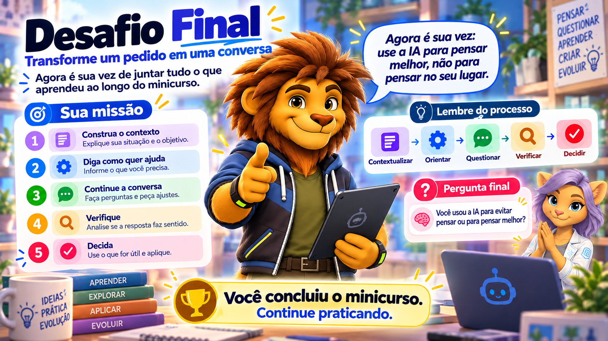

# Desafio Final — Transforme um pedido em uma conversa

## Agora é sua vez

Ao longo deste minicurso, você praticou cinco competências:

**Contextualizar → Orientar → Questionar → Verificar → Decidir**

Agora você vai utilizar todas elas em uma única atividade.

O objetivo não é criar um “prompt perfeito”.

O objetivo é construir uma conversa capaz de ajudar você a aprender ou realizar melhor uma tarefa.

---

## Situação inicial

Imagine que um estudante envie para uma IA apenas esta mensagem:

> Faça meu trabalho sobre sustentabilidade.

A IA pode produzir um texto.

Mas quase nada foi explicado.

Não sabemos:

- qual é a disciplina;
- qual é o nível do estudante;
- qual é o objetivo da atividade;
- o que o estudante já sabe;
- qual é sua dificuldade;
- que tipo de ajuda ele precisa;
- quais critérios o professor definiu.

Sua missão é transformar esse pedido em uma conversa mais útil.

---

## Etapa 1 — Construa o contexto

Antes de pedir qualquer resposta, pense nas informações que seriam importantes.

Por exemplo:

- O que você está estudando?
- Qual é a atividade?
- Qual é o objetivo?
- O que você já sabe?
- Onde está sua dificuldade?
- O que já tentou?

Agora escreva uma nova mensagem para a IA.

Ela deve explicar a situação sem pedir que a IA faça todo o trabalho.

---

## Etapa 2 — Diga como quer ajuda

Escolha o tipo de ajuda que seria mais útil neste momento.

Você pode pedir para a IA:

- explicar;
- fazer perguntas;
- revisar;
- comparar;
- organizar ideias;
- dar uma pista;
- propor uma situação para praticar;
- ajudar a localizar uma dificuldade.

Complete sua mensagem deixando claro como a IA deve ajudar.

---

## Etapa 3 — Continue a conversa

Leia a primeira resposta da IA.

Não encerre imediatamente.

Envie pelo menos mais uma mensagem.

Você pode:

- dizer o que ainda não entendeu;
- corrigir uma interpretação;
- pedir outro exemplo;
- mostrar uma tentativa;
- pedir uma pergunta para testar seu entendimento;
- solicitar uma explicação diferente.

A ideia é mostrar que uma boa interação não precisa acontecer em uma única mensagem.

---

## Etapa 4 — Verifique

Escolha uma informação importante apresentada pela IA.

Agora pense:

> Como posso verificar isso?

Você pode:

- consultar o material da aula;
- procurar uma fonte confiável;
- comparar com outra referência;
- testar um cálculo;
- consultar documentação;
- perguntar ao professor;
- analisar se a informação faz sentido.

Registre brevemente como você faria essa verificação.

---

## Etapa 5 — Decida

Depois de conversar e verificar, responda:

- O que você aproveitaria da resposta?
- O que mudaria?
- O que descartaria?
- O que ainda precisaria estudar?
- Você conseguiria explicar o resultado com suas próprias palavras?

A decisão final continua sendo sua.

---

## Agora escolha uma situação real

O exemplo de sustentabilidade foi apenas um ponto de partida.

Agora escolha uma atividade, conteúdo ou dificuldade que realmente faça parte dos seus estudos.

Pode ser, por exemplo:

- Matemática;
- Língua Portuguesa;
- História;
- Biologia;
- Administração;
- Edificações;
- Logística;
- Meio Ambiente;
- Recursos Humanos;
- Segurança do Trabalho;
- Design de Interiores;
- Agrimensura;
- Desenvolvimento de Sistemas;
- outra disciplina ou curso.

Use o mesmo processo:

**Contextualizar → Orientar → Questionar → Verificar → Decidir**

---

## Registro do desafio

Ao final, registre:

### 1. Pedido inicial

Qual seria o pedido genérico que você provavelmente faria antes deste minicurso?

### 2. Contexto construído

Como você explicou melhor a situação?

### 3. Forma de ajuda escolhida

O que pediu para a IA fazer?

### 4. Continuação da conversa

Que nova pergunta ou correção você fez depois da primeira resposta?

### 5. Verificação

Como conferiu uma informação importante?

### 6. Decisão final

O que aproveitou, modificou ou descartou?

### 7. Reflexão

Responda em poucas linhas:

> **O que mudou na forma como você conversou com a IA?**

---

## Não existe uma única resposta correta

Duas pessoas podem construir conversas diferentes para a mesma situação.

Isso não significa que uma delas esteja automaticamente errada.

O importante é observar se a conversa:

- fornece contexto suficiente;
- deixa claro o objetivo;
- define como a IA deve ajudar;
- permite participação ativa;
- inclui questionamento;
- verifica informações;
- mantém a decisão com o usuário.

---

## Um último teste

Antes de encerrar, pergunte a si mesmo:

> Eu usei a IA para evitar pensar ou para pensar melhor?

Essa pergunta pode ser mais importante do que qualquer prompt.

---

## Regra final

> **A IA pode ajudar a explicar, comparar, questionar, revisar e sugerir.  
> Mas compreender, verificar e decidir continua sendo responsabilidade humana.**

---

## Você concluiu o minicurso

Se você chegou até aqui, já possui uma base para trabalhar com Inteligência Artificial de forma mais consciente.

Você não precisa decorar fórmulas.

Não precisa procurar o “prompt perfeito”.

Precisa continuar praticando:

**Contextualizar → Orientar → Questionar → Verificar → Decidir**

> **Aprender a usar IA é aprender a conversar, verificar e decidir.**

[Voltar para o início](index.md)
